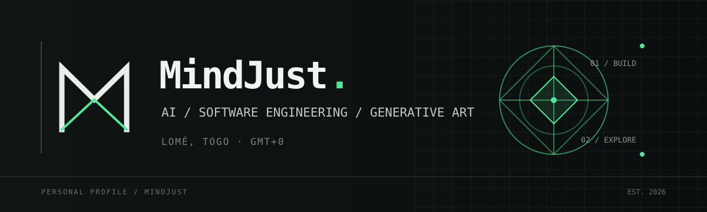

  

# Hi, I'm MindJust.

I'm an AI and software engineering student based in **Lomé, Togo**.

I enjoy building software, understanding how systems work, and exploring the creative side of code.

---

## What I'm into

- Artificial intelligence and machine learning
- Algorithms and data structures
- Systems programming
- Generative art and procedural graphics
- Software engineering

## Technologies

**Languages**  
Python · C · C++ · Rust · JavaScript · TypeScript

**Tools & frameworks**  
React · Next.js · PostgreSQL · Supabase · Linux · Git

## Education

**ESCEN — École Supérieure de Commerce et d'Économie Numérique**  
Artificial Intelligence & Software Engineering · 2025–present

**Harvard University**  
CS50x — Introduction to Computer Science · 2026

## Find me

- [GitHub](https://github.com/MindJust)
- [Kaggle](https://www.kaggle.com/petitsenfoirs)
- [CS50x certificate](https://cs50.harvard.edu/certificates/f3f4e615-1079-45bd-a27d-ab53ff800bcd)

---

BUILT IN LOMÉ · GH PROFILE / MINDJUST

