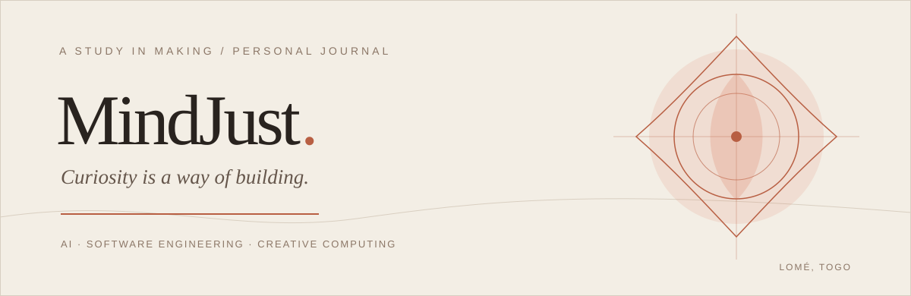

<!-- MINDJUST — A STUDY IN MAKING -->

  
    
  <a href="https://github.com/MindJust">GitHub</a>
  &nbsp;·&nbsp;
  <a href="https://www.kaggle.com/petitsenfoirs">Kaggle</a>
  &nbsp;·&nbsp;
  <a href="https://cs50.harvard.edu/certificates/f3f4e615-1079-45bd-a27d-ab53ff800bcd">CS50x Certificate</a>

 

---

## 01 &nbsp; / &nbsp; A little about me

I'm MindJust, an Artificial Intelligence and Software Engineering student based in **Lomé, Togo**.

I enjoy understanding how things work, exploring complex systems and turning ideas into something tangible.

My interests sit somewhere between artificial intelligence, low-level computing, mathematical thinking and creative experimentation. I'm especially drawn to the meeting point between technical precision and creative freedom.

 

## 02 &nbsp; / &nbsp; Areas of curiosity

  
  
  
  

| Field | Current interests |
|:--|:--|
| **Intelligence** | Machine learning, intelligent systems |
| **Computer science** | Algorithms, data structures |
| **Systems** | Systems programming, low-level computing |
| **Creative computing** | Generative art, procedural graphics |
| **Engineering** | Software design, architecture |

 

## Tools of the trade

**Languages** : Python, C, C++, Rust, JavaScript, TypeScript

**Frameworks & data**

React, Next.js, PostgreSQL, Supabase

**Environment**

Linux, Git

 

## The learning journey

<table>
  <tr>
    <td valign="top" width="50%">
      <strong>ESCEN</strong> 
      École Supérieure de Commerce et d'Économie Numérique  
      Artificial Intelligence &amp; Software Engineering 
      2025 — Present
    </td>
    <td valign="top" width="50%">
      <strong>Harvard University</strong> 
      CS50x · Introduction to Computer Science  
      <a href="https://cs50.harvard.edu/certificates/f3f4e615-1079-45bd-a27d-ab53ff800bcd">View certificate ↗</a> 
      2026
    </td>
  </tr>
</table>

 

---

   
  <em>“Stay curious. Make things. Understand why.”</em>
    
  INDEPENDENTLY THINKING &nbsp;·&nbsp; CONSTANTLY LEARNING
   
  MINDJUST &nbsp;·&nbsp; LOMÉ, TOGO

