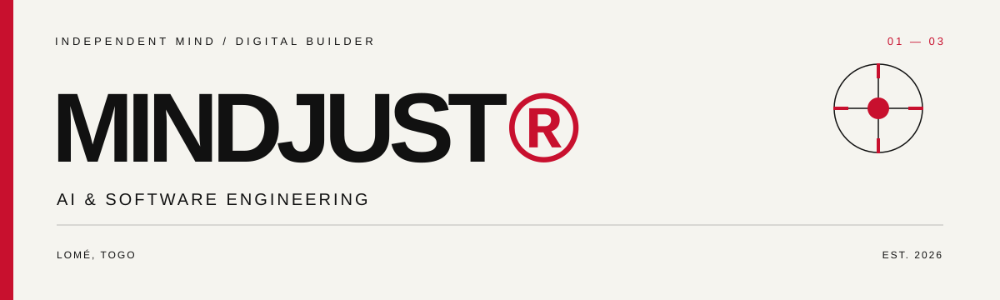

<!-- MINDJUST / VISUAL IDENTITY -->

  

  <samp>INDEPENDENT MIND&nbsp; / &nbsp;LOMÉ, TG&nbsp; / &nbsp;EST. 2026</samp>

<h1 align="center">MINDJUST</h1>

  <strong>FORM IS NEVER FINAL.</strong> 
  <samp>01 — ORDER&nbsp;&nbsp; / &nbsp;&nbsp;02 — NOISE&nbsp;&nbsp; / &nbsp;&nbsp;03 — FORM&nbsp;&nbsp; / &nbsp;&nbsp;↻</samp>

  AI&nbsp; · &nbsp;SOFTWARE ENGINEERING&nbsp; · &nbsp;GENERATIVE ART&nbsp; · &nbsp;EXPERIMENTAL DESIGN

---

  <strong>ORDER IS A MATERIAL.</strong> 
  A grid is not a cage. It is a set of conditions waiting to be disturbed.

  <samp>SEED&nbsp; / &nbsp;DENSITY&nbsp; / &nbsp;RHYTHM&nbsp; / &nbsp;DISPLACEMENT&nbsp; / &nbsp;DISTORTION&nbsp; / &nbsp;TENSION</samp>

  <strong>THE WORD IS THE MATERIAL.</strong> 
  LETTERFORM → PARTICLE → GRID → INTERRUPTION → RECOMPOSITION

---

## 01 / POSITION

I move between software engineering, intelligent systems and visual experimentation.

I build with rules, then test where they break. Code is both tool and medium; generative art is not decoration around the identity — it is the process that produces it.

## 02 / FIELD

**COMPUTATION**  
Artificial intelligence · Algorithms · Data structures · Computer systems

**EXPRESSION**  
Generative systems · Procedural graphics · Kinetic typography · Motion & interaction

## 03 / TOOLKIT

**LANGUAGES**  
Python · C · C++ · Rust · JavaScript · TypeScript

**BUILDING**  
React · Next.js · PostgreSQL · Supabase · Linux · Git

## 04 / FORMATION

**ESCEN** — École Supérieure de Commerce et d'Économie Numérique  
Artificial Intelligence & Software Engineering · 2025 — PRESENT

**HARVARD UNIVERSITY**  
CS50x · Introduction to Computer Science · 2026

---

  <a href="https://github.com/MindJust">GITHUB</a>
  &nbsp; / &nbsp;
  <a href="https://www.kaggle.com/petitsenfoirs">KAGGLE</a>
  &nbsp; / &nbsp;
  <a href="https://cs50.harvard.edu/certificates/f3f4e615-1079-45bd-a27d-ab53ff800bcd">CS50X</a>

  LOMÉ, TG&nbsp; — &nbsp;MINDJUST&nbsp; — &nbsp;STRUCTURE / NOISE / INTENTION&nbsp; — &nbsp;© 2026

