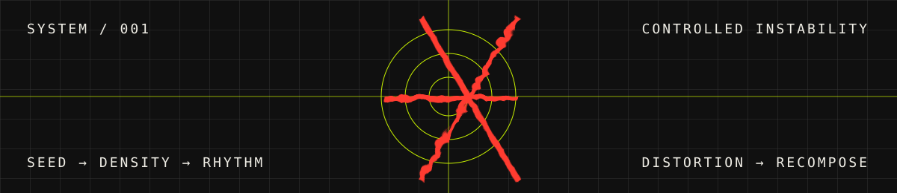

<!-- MINDJUST / GENERATIVE IDENTITY -->

  

<samp>INDEPENDENT MIND &nbsp; / &nbsp; LOMÉ, TG &nbsp; / &nbsp; EST. 2026</samp>

<strong>FORM IS NEVER FINAL.</strong> <samp>01 — ORDER &nbsp; / &nbsp; 02 — NOISE &nbsp; / &nbsp; 03 — FORM &nbsp; / &nbsp; ↻</samp>

## 01 / POSITION

I work across **AI, software engineering and generative art**.

Code is both tool and medium. I build systems from rules, then explore the instability inside them. The visual identity follows the same principle: a structure is established, disturbed and recomposed.

> **ORDER IS A MATERIAL.**  
> A grid is not a cage. It is a set of conditions waiting to be disturbed.

## 02 / GENERATIVE SYSTEM

`SEED` / `DENSITY` / `RHYTHM` / `DISPLACEMENT` / `DISTORTION` / `TENSION`

The wordmark is the raw material. Letterforms become particles; particles collide with the grid; interruptions produce new compositions.

## 03 / FIELD NOTES

| COMPUTATION | EXPRESSION |
|:--|:--|
| Artificial intelligence | Generative systems |
| Algorithms & data structures | Procedural graphics |
| Computer systems | Kinetic typography |
| Software engineering | Motion & interaction |

## 04 / TOOLKIT

**LANGUAGES**  
Python · C · C++ · Rust · JavaScript · TypeScript

**BUILDING**  
React · Next.js · PostgreSQL · Supabase · Linux · Git

## 05 / FORMATION

**ESCEN** — École Supérieure de Commerce et d'Économie Numérique  
Artificial Intelligence & Software Engineering · 2025 — PRESENT

**HARVARD UNIVERSITY**  
CS50x · Introduction to Computer Science · 2026

---

  <a href="https://github.com/MindJust">GITHUB</a> &nbsp; / &nbsp;
  <a href="https://www.kaggle.com/petitsenfoirs">KAGGLE</a> &nbsp; / &nbsp;
  <a href="https://cs50.harvard.edu/certificates/f3f4e615-1079-45bd-a27d-ab53ff800bcd">CS50X</a>

LOMÉ, TG — MINDJUST — STRUCTURE / NOISE / INTENTION — © 2026

